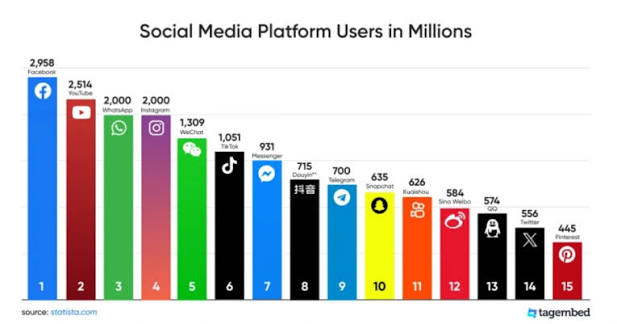
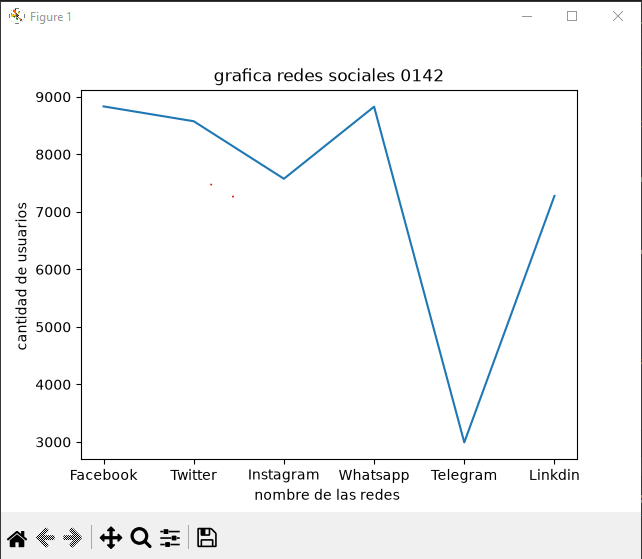
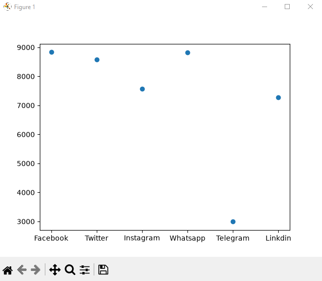
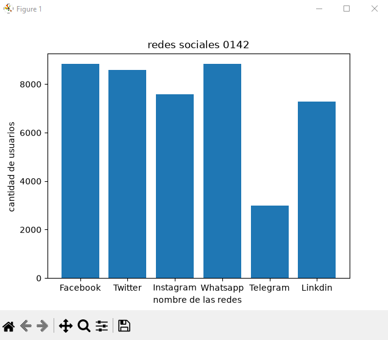
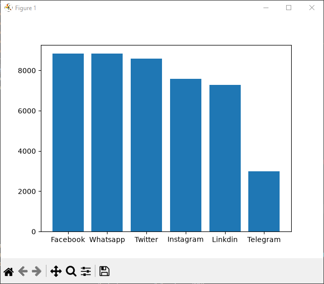
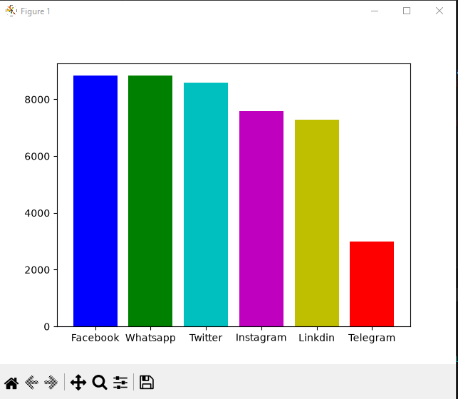
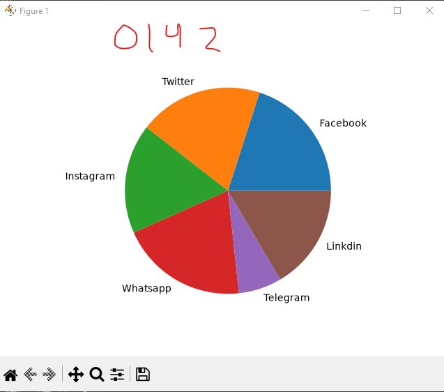

## dataframe o marco de datos panda

## redes sociales a nivel global 

## grafica lineal de redes sociales 

## grafica de puntos  de redes sociales 

## grafica de barras de redes sociales 

# grafica de barras del mas grande al mas chico descendente

## coloreando la grafica

## grafica de pastel o pie 

